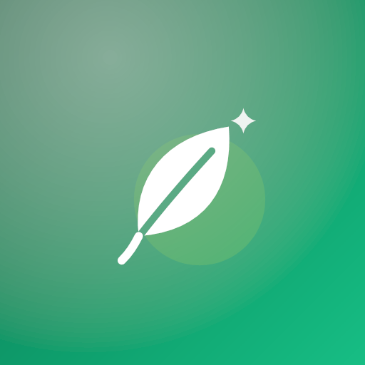
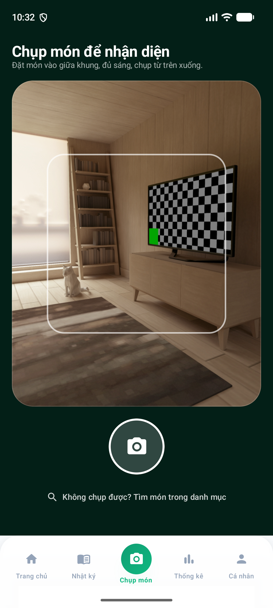
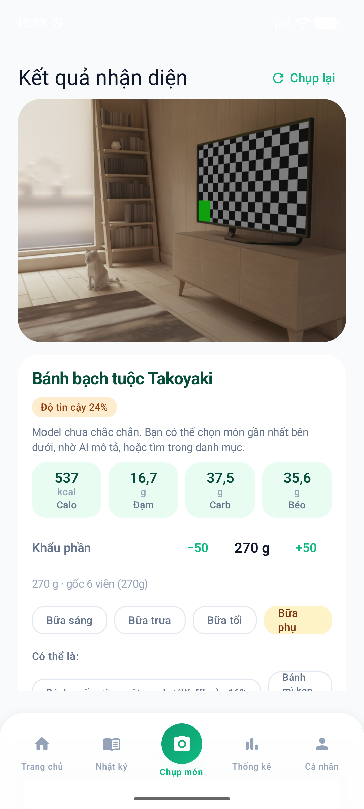
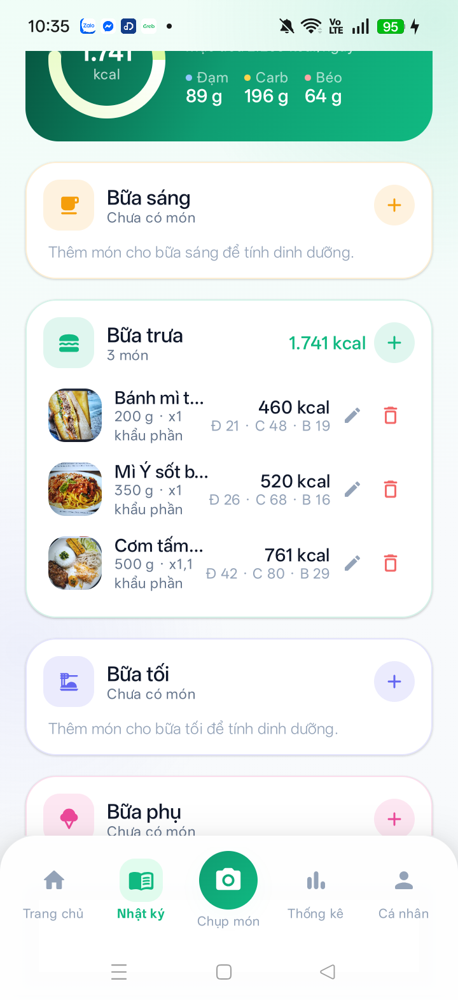
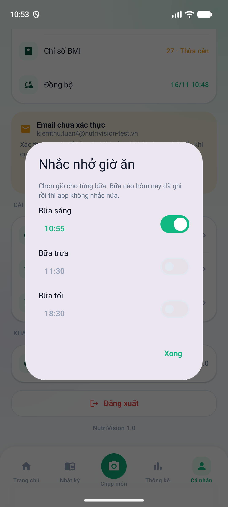

# NutriVision

<p align="center">
  
</p>

Ứng dụng Android nhận diện món ăn từ ảnh, tính dinh dưỡng theo khẩu phần và đồng bộ nhật ký ăn uống giữa các thiết bị của cùng một tài khoản. Đồ án môn **Lập trình thiết bị di động**.

| | |
|---|---|
| Nền tảng | Android 7.0+ (API 24), `compileSdk`/`targetSdk` 37 |
| Ngôn ngữ | Kotlin 2.2.10 · Jetpack Compose · MVVM |
| Phiên bản | 1.0 (versionCode 1) |
| Nhận diện | MobileNetV3-Large → TensorFlow Lite, **131 lớp**, chạy trên máy |
| Lưu trữ | Room (nguồn dữ liệu chính) + Firebase Firestore (đồng bộ) |
| Đăng nhập | Firebase Authentication (email + mật khẩu, xác thực qua link) |

---

## Tính năng

**Nhận diện món**
- Chụp ảnh bằng CameraX hoặc **chọn ảnh có sẵn** từ thư viện.
- TFLite chạy hoàn toàn trên máy: top-1 khi tin cậy ≥ 0.70, dưới ngưỡng thì hiện top-3 kèm % để người dùng chọn.
- Món lạ hoặc model đoán sai: gọi **Gemini** để mô tả lại (cần mạng), kết quả được đánh dấu *"AI ước lượng"*.

**Nhật ký ăn uống**
- 4 bữa/ngày (sáng, trưa, tối, phụ), thêm/sửa/xoá món, đổi khẩu phần gram và tự nhân lại dinh dưỡng.
- Ảnh món thật của người dùng hiện trong nhật ký và màn sửa khẩu phần; xoá món thì dọn luôn file ảnh không còn dùng.
- Tìm món theo tên có dấu hoặc **không dấu** (gõ "pho bo" ra "Phở bò").
- Thống kê theo tuần/tháng (calo, đạm, carb, béo so với mục tiêu); Trang chủ tóm tắt ngày đang chọn.

**Tài khoản & đồng bộ**
- Đăng ký/đăng nhập Firebase, gửi link xác thực email, quên mật khẩu.
- Hồ sơ (chiều cao, cân nặng, tuổi, giới, mức vận động) → tính BMR/TDEE và mục tiêu calo.
- Đồng bộ Firestore **tự động, không có nút bấm tay**: mở app, ~2 giây sau khi dữ liệu đổi, và khi quay lại app sau hơn 5 phút.
- Xung đột giải quyết theo *last-write-wins* trên `updated_at`; xoá dùng tombstone `deleted_at` để máy khác xoá theo.

**Nhắc nhở & giao diện**
- Nhắc ăn theo từng bữa, giờ tự chỉnh, **mặc định tắt**; chỉ xin quyền thông báo khi người dùng bật.
- Song ngữ Việt/Anh, giao diện theo hệ thống hoặc sáng/tối.
- Hộp thoại "Về NutriVision" hiện phiên bản thật (`BuildConfig`), email đang đăng nhập và trạng thái xác thực.

<p align="center">
  
  
  
  
</p>

---

## Kiến trúc

```text
UI (Compose)  →  ViewModel  →  Repository  →  Room (SQLite)
                                    │
                                    └────→  Firebase Firestore   (đồng bộ 2 chiều)
                                             Firebase Auth       (phiên đăng nhập)
```

- **Room là nguồn dữ liệu chính**: mọi màn hình đọc từ Room, app dùng bình thường khi mất mạng.
- **Firestore chỉ đồng bộ**: đẩy thay đổi cục bộ lên và kéo thay đổi từ máy khác về; không có màn hình nào đọc trực tiếp từ mạng.
- Đồng bộ chống vòng lặp: chỉ đổi `sync_status`, **không** đổi `updated_at`.

### Cấu trúc thư mục

```text
app/src/main/java/com/example/nutrivision/
├── data/          Room (entity, dao, database), repository, Firestore, Gemini, prefs
├── domain/        Model + NutritionCalculator (BMR/TDEE, macro)
├── notifications/ WorkManager, lịch nhắc bữa ăn
├── di/            AppContainer (dựng dependency thủ công, không dùng Hilt)
└── ui/            Compose screens, components, theme, viewmodel
app/src/main/assets/   model.tflite, labels.txt, class_names_vi.json, foods_nutrition.json
```

---

## Mô hình nhận diện

| Thông số | Giá trị |
|---|---|
| Model | MobileNetV3-Large, `model.tflite` **3,3 MB** |
| Đầu vào | 224 × 224, float32, giá trị **0–255** (chuẩn hoá nằm trong model) |
| Số lớp | **131** = 101 món Việt + 30 món ngoại |
| Ngưỡng tin cậy | 0.70 (dưới ngưỡng → hiện top-3) |
| Số đo trên test set | **top-1 76,5 % · top-3 89,8 %** (9.814 ảnh, cùng nguồn dataset) |

Top-3 là 3 món có xác suất cao nhất trong **cùng một lần dự đoán**, không phải 3 lần đoán độc lập và không cộng lại thành 100 %.

- Huấn luyện: [`ai_tools/HUONG_DAN_AI_131MON.md`](ai_tools/HUONG_DAN_AI_131MON.md) · notebook [`ai_tools/Train_NutriVision_131.ipynb`](ai_tools/Train_NutriVision_131.ipynb)
- Dữ liệu dinh dưỡng: **145 món**, mỗi món ghi rõ nguồn (`direct` / `recipe` / `estimate`) và có `*_per_100g` để tính lại khi đổi khẩu phần — xem [`ai_tools/NGUON_DINH_DUONG.md`](ai_tools/NGUON_DINH_DUONG.md).

> Số đo trên là ảnh trong tập test cùng nguồn dataset, không phải ảnh tự chụp ngoài đời. Ảnh thực tế trong nhà thường thấp hơn, vì vậy app luôn cho chọn lại món.

### Nguyên tắc dữ liệu

- Không bịa số liệu: thiếu dữ liệu thì hiện `–` / *"Chưa có dữ liệu"* / *"No data"*.
- Gemini chỉ chạy khi người dùng bấm *"Nhờ AI mô tả"* / *"Nhận diện sai? Nhờ AI xem lại"*. Món do AI tạo được lưu với `is_custom = 1` và gắn nhãn **"AI ước lượng"** — đây là con số ước lượng, không phải phép đo.
- Mọi chữ trên giao diện đều đi qua `tr("vi", "en")`.

---

## Đồng bộ Firestore

```text
users/{uid}                      hồ sơ + mục tiêu dinh dưỡng
users/{uid}/meals/{mealId}       bữa ăn
users/{uid}/meal_items/{itemId}  món trong bữa (để phẳng)
users/{uid}/meal_photos/{itemId} ảnh món đã nén (base64)
```

| Thời điểm | Cơ chế |
|---|---|
| Mở app / đăng nhập | Đồng bộ ngay, giới hạn 6 giây |
| Dữ liệu đổi | Nghe "vân tay" Room (`COUNT(*)` + `MAX(updated_at)`), gộp bằng debounce 2 giây |
| Quay lại app sau > 5 phút | Kéo thay đổi từ máy khác về |

- Ghi theo batch tối đa **400** thao tác/lượt.
- Luật bảo mật: mỗi tài khoản chỉ đọc/ghi `users/{uid}/**` ([`firestore.rules`](firestore.rules)).

### Ảnh món: không dùng Firebase Storage

Firebase Storage yêu cầu gói **Blaze có trả phí**, nên ảnh được đồng bộ qua Firestore:

- Ảnh gốc nằm trên máy đã chụp (`files/photos/<uuid>.jpg`; ảnh camera giữ full độ phân giải, ảnh chọn từ thư viện được thu về tối đa 1600 px).
- Bản gửi lên mây được nén **cạnh dài đúng 720 px, JPEG q70** (~40–90 KB, có trần 200 KB) rồi mã hoá base64 → document `meal_photos/{itemId}`.
- Document món chỉ giữ cờ `has_photo` + `photo_v` (phiên bản nén); máy khác chỉ tải đúng ảnh còn thiếu, không quét cả collection.
- Máy đã có bản nén sẽ **không** gửi ngược lên, tránh nén chồng làm ảnh mờ dần.
- Xoá món thì ảnh trên mây cũng bị xoá.

---

## Cài đặt và chạy

**Yêu cầu:** Android Studio (SDK 37), JDK 17 trở lên, thiết bị/emulator Android 7.0+.

```bash
git clone https://github.com/MinhNews/NutriVision.git
cd NutriVision
./gradlew :app:assembleDebug        # Windows: .\gradlew.bat :app:assembleDebug
./gradlew :app:testDebugUnitTest    # 39 unit test
```

- `app/google-services.json` đã có sẵn cho project demo `nutrivision-9c3a3`. Dùng Firebase project khác thì thay file này và publish `firestore.rules`:
  ```bash
  firebase deploy --only firestore:rules
  ```
- **Khoá Gemini không nằm trong repo.** Thêm vào `local.properties` (đã gitignore):
  ```properties
  gemini.api.key=YOUR_KEY
  ```
  Không có khoá thì nút "Nhờ AI mô tả" tự ẩn, app vẫn chạy đầy đủ bằng model trên máy.

> Khoá nhúng qua `BuildConfig` chỉ phù hợp cho đồ án/demo. Bản phát hành thật nên gọi Gemini qua Cloud Functions hoặc khoá giới hạn theo package.

---

## Kiểm thử

| Loại | Kết quả | Nội dung |
|---|---|---|
| Unit test | **39/39 xanh** | Kiểm tra email/mật khẩu/điều khoản, nhận dữ liệu cũ, BMR–TDEE, tìm không dấu, lịch nhắc |
| Instrumented test | **3/3 xanh** | Chạy model thật trên thiết bị: top-1 ≥ 50 % trên 131 ảnh mẫu, ảnh xám không vượt ngưỡng |
| Thử tay trên máy thật | Đạt | Đăng nhập, chụp/nhận diện, Gemini, chọn ảnh, nhắc nhở, đồng bộ, khôi phục ảnh |

---

## Tài liệu

- [Báo cáo tuần 4 — Firebase Auth, camera + AI, đồng bộ, nhắc nhở](docs/Tuan4/BAO_CAO_TUAN4.md)
- [Báo cáo tuần 3 — cơ sở dữ liệu](docs/Tuan3/BAO_CAO_TUAN3.md)
- [Thiết kế UI & luồng màn hình (tuần 2)](docs/Tuan2/02_Screen_Flow_va_Navigation.md)
- [Phân tích đề tài & dataset (tuần 1)](docs/Tuan1/README.md)

## Giới hạn đã biết

- Model **không có lớp đồ uống**; ảnh đồ uống thường bị đoán sang món ăn gần nhất.
- Máy thứ hai nhận ảnh **đã nén 720 px**, không phải ảnh gốc full độ phân giải.
- Đồng bộ và Gemini cần mạng; mất mạng app vẫn dùng bình thường và tự thử lại sau.
- Nhắc nhở dựa trên giờ máy, có thể trễ vài phút nếu hệ điều hành tắt tiết kiệm pin mạnh.
