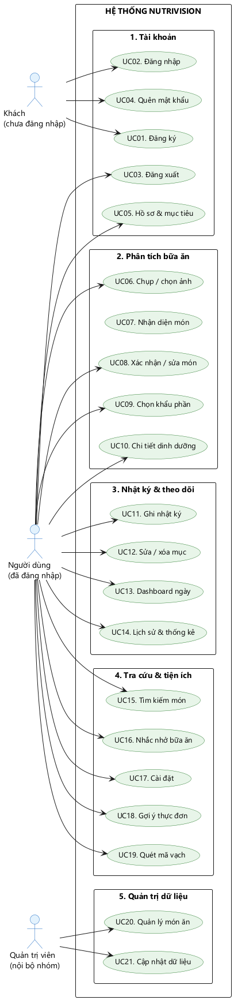
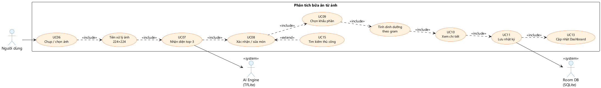

# BÁO CÁO TUẦN 1 — MÔ TẢ ĐỀ TÀI

**Môn học:** Lập trình di động
**Lớp:** ....................  **Nhóm:** .................... (3 thành viên)
**Giảng viên hướng dẫn:** Lê Minh Trí
**Ngày báo cáo:** ....../....../2026

| STT | Họ và tên | MSSV | Vai trò |
|---|---|---|---|
| 1 | .............................. | .............. | Nhóm trưởng – Android Lead |
| 2 | .............................. | .............. | Data & Backend Engineer |
| 3 | .............................. | .............. | UI/UX & QA Lead |

---

## BẢNG ĐỐI CHIẾU YÊU CẦU TUẦN 1

| Yêu cầu của đề bài | Nội dung trong báo cáo |
|---|---|
| Tên đề tài | Mục 1.1 |
| Lý do chọn | Mục 1.2 |
| Mục đích của ứng dụng | Mục 1.3 |
| Ứng dụng phục vụ ai | Mục 2.1 |
| Giải quyết vấn đề gì | Mục 2.2 |
| 2–3 ứng dụng tương tự, so sánh ưu nhược | Mục 3 |
| Chức năng chính | Mục 4.1 |
| Chức năng mở rộng | Mục 4.2 |
| Sơ đồ Use Case | Mục 5 + Hình 1, Hình 2 |
| Chọn công nghệ | Mục 6 |
| Phân công công việc | Mục 7 |

---

# 1. TỔNG QUAN ĐỀ TÀI

## 1.1. Tên đề tài

> ### NutriVision – Ứng dụng phân tích dinh dưỡng món ăn từ hình ảnh

**Tên đầy đủ trên bìa báo cáo:**
*NutriVision: Xây dựng ứng dụng Android phân tích dinh dưỡng bữa ăn Việt Nam từ hình ảnh bằng học sâu trên thiết bị.*

**Slogan:** *"Chụp một bức ảnh – biết ngay bữa ăn của bạn"*

**Tên ứng dụng:** NutriVision · **Nền tảng:** Android (API 26+) · **Ngôn ngữ giao diện:** Tiếng Việt

## 1.2. Lý do chọn đề tài

**a) Xuất phát từ nhu cầu thực tế.**
Chế độ ăn nhiều đường, nhiều muối và dầu mỡ là một trong những yếu tố nguy cơ của các bệnh không lây nhiễm. Với người thường xuyên ăn ngoài, khó khăn đầu tiên không hẳn là thiếu kiến thức mà là **không biết mình đang ăn bao nhiêu**. Kiểm soát dinh dưỡng là việc hiệu quả nhưng khó duy trì, vì mỗi bữa đều phải ghi lại thủ công.

> *Ghi chú của nhóm:* mục này sẽ bổ sung số liệu thống kê có nguồn (niên giám y tế, WHO) khi hoàn thiện báo cáo. Ở tuần 1, nhóm chưa đưa con số vì chưa kiểm chứng được.

**b) Điểm đau cụ thể của người dùng.**
Các ứng dụng đếm calo hiện nay yêu cầu **gõ tên món → chọn khẩu phần → chọn đơn vị → lưu**. Khi cài thử ba ứng dụng, nhóm nhận thấy đây là khâu mất thời gian nhất trong toàn bộ luồng, và cũng là khâu dễ khiến người dùng bỏ ngang. Nếu chỉ cần **chụp một bức ảnh** là đã có thông tin đầu vào, số thao tác sẽ giảm đi đáng kể.

> Thời gian tiết kiệm được bao nhiêu là **giả thuyết**, sẽ đo trên bản thử ở tuần 4 (xem mục 2.2 và 7.3).

**c) Khoảng trống về dữ liệu Việt Nam.**
Các ứng dụng nổi tiếng (MyFitnessPal, Foodvisor, Calorie Mama) có kho dữ liệu rất lớn, nhưng phần **món Việt** trong đó còn mỏng: nhiều món quen thuộc như phở, bún bò Huế, cơm tấm, bánh mì, gỏi cuốn chưa có hoặc có với tên dịch máy, khẩu phần theo đơn vị nước ngoài (cup, oz). Trong phạm vi ba ứng dụng nhóm đã dùng thử, chưa có ứng dụng nào lấy **món Việt + khẩu phần Việt** làm trọng tâm.

> *Cách kiểm tra:* nhóm tìm 10 món Việt phổ biến trong bản miễn phí của từng ứng dụng; kết quả và ảnh chụp màn hình ghi ở phụ lục.

**d) Phù hợp mục tiêu môn học.**
Đề tài vận dụng được nhiều mảng kiến thức trọng tâm của môn Lập trình di động: thiết kế giao diện, camera, xử lý ảnh, cơ sở dữ liệu cục bộ (Room/SQLite), gọi API, thông báo, phân quyền, đóng gói phát hành — đồng thời có thêm một lớp công nghệ mới (học sâu trên thiết bị) để tạo khác biệt.

**e) Có tính mở rộng.**
Từ bản tối thiểu (MVP) có thể phát triển thành trợ lý dinh dưỡng cá nhân hóa: gợi ý thực đơn, theo dõi bệnh lý, đồng bộ đa thiết bị, tích hợp thiết bị đeo.

## 1.3. Mục đích của ứng dụng

**Mục đích tổng quát:**
Giúp người dùng Việt Nam **kiểm soát dinh dưỡng hằng ngày với ít thao tác nhất**, bằng cách biến một bức ảnh chụp bữa ăn thành dữ liệu dinh dưỡng có thể theo dõi, đánh giá và cải thiện.

**Mục tiêu cụ thể (đo lường được):**

| Mã | Mục tiêu | Chỉ số đánh giá |
|---|---|---|
| M1 | Ghi nhận một bữa ăn nhanh | ≤ 15 giây/bữa (chụp → xác nhận → lưu) |
| M2 | Nhận diện đúng món trong top-3 | ≥ 80% trên 15 món đã huấn luyện |
| M3 | Có dữ liệu dinh dưỡng món Việt | ≥ 100 món, đủ 6 chỉ số: calo, đạm, carb, béo, xơ, natri |
| M4 | Theo dõi được tiến độ | Biểu đồ 7 ngày / 30 ngày + so sánh với mục tiêu |
| M5 | Hoạt động không cần mạng | 100% chức năng cốt lõi chạy offline |

**Giá trị khác biệt (USP):** nhanh hơn (ảnh thay vì gõ) – Việt hơn (món Việt, khẩu phần Việt, tiếng Việt) – riêng tư hơn (ảnh và nhật ký lưu trên máy, không cần tài khoản trả phí).

---

# 2. NGƯỜI DÙNG VÀ VẤN ĐỀ

## 2.1. Ứng dụng phục vụ ai?

### Persona 1 — Sinh viên / nhân viên văn phòng muốn giảm cân (nhóm chính)

- **Hồ sơ:** 18–30 tuổi, ăn ngoài 2–3 bữa/ngày, dùng điện thoại Android tầm trung.
- **Mục tiêu:** giảm cân từ từ, giữ được thói quen ghi chép.
- **Nỗi đau:** đã thử ghi chép calo nhưng bỏ ngang vì mất thời gian; không biết món ăn ngoài quán có bao nhiêu calo.
- **Cần gì:** ghi bữa ăn trong vài bước; biết hôm nay còn được ăn bao nhiêu.

### Persona 2 — Người tập luyện (nhóm chính)

- **Hồ sơ:** 20–35 tuổi, tập gym/chạy bộ 3–5 buổi/tuần.
- **Mục tiêu:** tăng cơ, kiểm soát đạm và tổng calo.
- **Nỗi đau:** khó ước lượng đạm của món Việt; không thấy xu hướng theo tuần.
- **Cần gì:** xem nhanh macro của món; thống kê 7/30 ngày.

### Persona 3 — Người có bệnh lý cần kiểm soát chế độ ăn (nhóm phụ)

- **Hồ sơ:** người có chỉ định của bác sĩ, hoặc người chăm sóc người thân.
- **Mục tiêu:** hạn chế đường, muối, chất béo.
- **Nỗi đau:** không biết món ăn chứa bao nhiêu muối/đường; thông tin rải rác, khó đối chiếu.
- **Cần gì:** cảnh báo khi vượt ngưỡng; dữ liệu có nguồn rõ ràng.
- **Giới hạn:** ứng dụng **không chẩn đoán và không thay thế tư vấn y tế**; nhóm chỉ dừng ở mức nhắc nhở và hiển thị dữ liệu.

> *Ghi chú:* tỉ lệ phần trăm giữa các persona sẽ được cập nhật sau khảo sát 30 người ở tuần 2. Tuần 1 nhóm chưa đưa con số vì chưa có dữ liệu.

### Actor phụ (tác nhân hệ thống)

| Actor | Vai trò |
|---|---|
| Quản trị viên (nội bộ nhóm) | Quản lý danh mục món và dữ liệu dinh dưỡng (qua công cụ/CSV) |
| AI Engine (TFLite) | Nhận diện món ăn, trả về top-3 nhãn kèm độ tin cậy |
| API dinh dưỡng (bên ngoài) | Tra cứu bổ sung cho món chưa có trong cơ sở dữ liệu nội bộ |

## 2.2. Ứng dụng giải quyết vấn đề gì?

| # | Vấn đề của người dùng | Cách NutriVision giải quyết |
|---|---|---|
| P1 | Ghi nhật ký ăn uống thủ công mất thời gian → dễ bỏ ngang | Chụp ảnh → AI gợi ý món → xác nhận một chạm. Mục tiêu: rút số thao tác xuống còn 4 bước (thời gian cụ thể đo ở tuần 4) |
| P2 | Không biết món Việt mình ăn bao nhiêu calo, đạm, đường, muối | Cơ sở dữ liệu 100+ món Việt với 6 chỉ số trên 100 g + quy đổi theo khẩu phần thực tế (tô, bát, đĩa, cái) |
| P3 | Ứng dụng nước ngoài thiếu món Việt, tên dịch máy, đơn vị lạ | Ứng dụng Việt hóa toàn bộ, lấy món Việt và khẩu phần Việt làm trung tâm |
| P4 | Ăn xong không biết hôm nay đã ăn bao nhiêu so với mục tiêu | Dashboard vòng tròn calo + thanh macro theo mục tiêu cá nhân (BMI, TDEE) |
| P5 | Không thấy tiến bộ nên mất động lực | Biểu đồ 7/30 ngày, chuỗi ngày ghi chép liên tiếp (streak) |
| P6 | Hay quên ghi bữa ăn | Nhắc nhở theo giờ bằng thông báo cục bộ (không cần server) |
| P7 | Ước lượng khẩu phần sai (tô nhỏ và tô lớn có thể chênh nhau đáng kể) | Chọn khẩu phần theo đơn vị thực tế (nửa tô / 1 tô / tô lớn, gram) và quy đổi tự động |

## 2.3. Phạm vi của đề tài

**Trong phạm vi:**
- Ứng dụng Android, tiếng Việt, chạy offline với cơ sở dữ liệu nội bộ.
- Nhận diện 15 món Việt phổ biến bằng model chạy trên thiết bị.
- Ghi nhật ký, tính dinh dưỡng, thống kê, nhắc nhở.

**Ngoài phạm vi (nói rõ để tránh kỳ vọng sai):**
- Không chẩn đoán bệnh, không thay thế bác sĩ/chuyên gia dinh dưỡng.
- Không ước lượng khẩu phần tự động bằng AI (người dùng chọn).
- Không xây dựng website quản trị riêng.
- Không phát triển phiên bản iOS trong học kỳ này.

---

# 3. ỨNG DỤNG TƯƠNG TỰ VÀ SO SÁNH

> **Cách nhóm tìm hiểu:** cài và dùng thử bản miễn phí của ba ứng dụng dưới đây trong hai tuần, ghi lại những gì làm được và những gì chưa làm được. Phần so sánh chỉ nhằm trả lời câu hỏi "nhóm nên làm gì cho phù hợp với mục tiêu đồ án", **không phải đánh giá toàn diện sản phẩm của họ** — cả ba đều là sản phẩm thương mại có đội ngũ lớn, làm tốt hơn nhóm ở rất nhiều mặt.

## 3.1. MyFitnessPal (Mỹ)

**Điểm mạnh:** cơ sở dữ liệu thực phẩm rất lớn, quét mã vạch tốt, theo dõi được nhiều chỉ số cùng lúc, có cộng đồng đông và biểu đồ chi tiết.

**Điều nhóm chưa làm được như họ:** kho dữ liệu và cộng đồng — nhóm chỉ làm khoảng 100 món.

**Nhóm học được:** dữ liệu là phần nền của một ứng dụng dinh dưỡng. Vì vậy nhóm đặt việc xây dựng dữ liệu món Việt lên trước phần giao diện.

## 3.2. Foodvisor (Pháp)

**Điểm mạnh:** ghi bữa ăn bằng ảnh, luồng thao tác gọn, có thêm phần hướng dẫn của chuyên gia dinh dưỡng.

**Điều nhóm chưa làm được như họ:** chưa có chuyên gia tư vấn; nhóm chỉ dừng ở mức cảnh báo theo ngưỡng.

**Nhóm học được:** ước lượng khẩu phần tự động là bài toán khó, sai số lớn nếu chỉ nhìn ảnh (xem mục 6.3). Nhóm chọn cách để người dùng xác nhận khẩu phần — chậm hơn một chút nhưng minh bạch và giải thích được.

## 3.3. Calorie Mama (nhận diện qua API)

**Điểm mạnh:** nhận diện món qua API, tích hợp nhanh, xử lý được ảnh có nhiều món.

**Điều nhóm chưa làm được như họ:** chưa nhận diện được nhiều món trong một ảnh.

**Nhóm học được:** gọi API là cách nhanh để có kết quả, nhưng phụ thuộc mạng và hạn mức gọi. Với đồ án cần demo ổn định, nhóm chọn mô hình chạy ngay trên máy và chỉ để API làm kênh bổ sung.

## 3.4. Bảng so sánh tổng hợp

| Tiêu chí | MyFitnessPal | Foodvisor | Calorie Mama | **NutriVision (nhóm)** |
|---|---|---|---|---|
| Nhận diện từ ảnh | Có (gói trả phí) | Có | Có | **Có, chạy trên máy** |
| Dữ liệu món Việt | Ít | Ít | Ít | **15 món huấn luyện + 100 món tra cứu** |
| Khẩu phần kiểu Việt | Không | Không | Không | **Tô, bát, cái** |
| Tiếng Việt | Một phần | Không | Không | **Toàn bộ** |
| Dùng khi không có mạng | Hạn chế | Hạn chế | Hạn chế | **Toàn bộ chức năng chính** |
| Chi phí | Miễn phí + gói trả phí | Miễn phí + gói trả phí | Miễn phí + gói trả phí | **Miễn phí (đồ án)** |
| Quyền riêng tư | Đám mây | Đám mây | Đám mây | **Lưu trên thiết bị** |

*Ghi chú: "Ít" = nhóm tìm vài món phổ biến (phở, cơm tấm, bún bò) trong bản miễn phí mà không thấy kết quả phù hợp; ảnh chụp màn hình ở phụ lục. Thông tin ghi nhận tháng 11/2026 và có thể đã thay đổi.*

## 3.5. Kết luận định vị

Nhóm **không đặt mục tiêu làm tốt hơn** ba ứng dụng trên. Mục tiêu là một sản phẩm nhỏ, dữ liệu món Việt, chạy được khi không có mạng — đủ để học và đủ để dùng thật trong phạm vi 6 tuần.

---

# 4. CHỨC NĂNG CỦA ỨNG DỤNG

## 4.1. Chức năng chính (bắt buộc hoàn thành ở tuần 4)

| ID | Chức năng | Mô tả | Ưu tiên |
|---|---|---|---|
| F1 | Đăng ký tài khoản | Email + mật khẩu; kiểm tra định dạng email, mật khẩu ≥ 6 ký tự, xác nhận mật khẩu | Cao |
| F2 | Đăng nhập / Đăng xuất | Email + mật khẩu, ghi nhớ phiên đăng nhập, quên mật khẩu qua email | Cao |
| F3 | Hồ sơ & mục tiêu cá nhân | Tuổi, giới, chiều cao, cân nặng, mức vận động → tính BMI, TDEE → mục tiêu calo/ngày | Cao |
| F4 | Chụp / chọn ảnh món ăn | CameraX hoặc thư viện ảnh; nén ảnh trước khi xử lý | Cao |
| F5 | Nhận diện món từ ảnh | Model TFLite trả về top-3 món kèm độ tin cậy | Cao |
| F6 | Xác nhận / sửa món | Chọn đúng món trong top-3 hoặc tìm thủ công (bước an toàn của AI) | Cao |
| F7 | Chọn khẩu phần | Chọn đơn vị thực tế (nửa tô / 1 tô / tô lớn, cái, gram) → tính lại dinh dưỡng | Cao |
| F8 | Xem chi tiết dinh dưỡng | Calo, đạm, carb, béo, chất xơ, đường, natri; cảnh báo khi vượt ngưỡng | Cao |
| F9 | Ghi nhật ký bữa ăn | Thêm vào bữa Sáng/Trưa/Tối/Snack theo ngày; sửa và xóa mục đã ghi | Cao |
| F10 | Dashboard trong ngày | Vòng tròn calo còn lại + 3 thanh macro + danh sách món đã ăn | Cao |
| F11 | Tìm kiếm & lọc món | Tìm theo tên (có dấu/không dấu), lọc theo nhóm món | Cao |
| F12 | Lịch sử & thống kê | Xem theo ngày; biểu đồ 7 ngày / 30 ngày; calo trung bình | Trung bình |
| F13 | Thông báo nhắc nhở | Nhắc ghi bữa theo giờ, bật/tắt trong Cài đặt | Trung bình |
| F14 | Cài đặt | Đơn vị đo, chế độ tối, xóa toàn bộ dữ liệu, đăng xuất | Trung bình |

## 4.2. Chức năng mở rộng (làm nếu còn thời gian)

| ID | Chức năng | Ghi chú |
|---|---|---|
| E1 | Gợi ý thực đơn theo calo còn lại | Dễ làm từ dữ liệu nội bộ, hiệu quả khi demo |
| E2 | Quét mã vạch sản phẩm đóng gói | Dùng ML Kit Barcode |
| E3 | Trợ lý dinh dưỡng dùng mô hình ngôn ngữ lớn | Chỉ để gợi ý, không dùng làm số liệu chính |
| E4 | Đồng bộ đám mây đa thiết bị | Firebase Firestore |
| E5 | Xuất báo cáo PDF / chia sẻ ảnh tổng kết | Dùng PdfDocument |
| E6 | Nhận diện nhiều món trong một ảnh | Chỉ làm nếu model đủ tốt |
| E7 | Widget màn hình chính / đồng hồ thông minh | Nêu ở phần hướng phát triển |
| E8 | Cộng đồng chia sẻ món ăn | Cần backend và kiểm duyệt, không làm |
| E9 | Chuỗi ngày ghi chép & huy hiệu | Tăng động lực sử dụng |

## 4.3. Ngoài phạm vi

Không chẩn đoán bệnh; không ước lượng khẩu phần tự động; không có website quản trị; không hỗ trợ iOS trong học kỳ này.

---

# 5. SƠ ĐỒ USE CASE

## 5.1. Danh sách Actor

| Actor | Loại | Mô tả |
|---|---|---|
| Khách | Chính | Người chưa đăng nhập: đăng ký, đăng nhập, quên mật khẩu |
| Người dùng | Chính | Người đã đăng nhập: toàn bộ chức năng nghiệp vụ |
| Quản trị viên | Chính | Quản lý danh mục món và dữ liệu dinh dưỡng |
| AI Engine (TFLite) | Phụ (hệ thống) | Nhận diện món, trả về top-3 nhãn |
| API dinh dưỡng | Phụ (hệ thống) | Tra cứu bổ sung món ngoài cơ sở dữ liệu |

## 5.2. Sơ đồ Use Case tổng quát



*Hình 1. Sơ đồ Use Case tổng quát của hệ thống NutriVision (21 use case, 5 nhóm chức năng).*

## 5.3. Sơ đồ Use Case chi tiết: "Phân tích bữa ăn từ ảnh"



*Hình 2. Luồng use case chi tiết từ chụp ảnh đến cập nhật Dashboard, thể hiện quan hệ include/extend.*

## 5.4. Đặc tả ba use case tiêu biểu

### UC01 — Đăng ký tài khoản

| Mục | Nội dung |
|---|---|
| Actor | Khách |
| Mục đích | Tạo tài khoản để lưu nhật ký riêng |
| Tiền điều kiện | Chưa đăng nhập |
| Luồng chính | 1. Mở màn Đăng ký → 2. Nhập email, mật khẩu, xác nhận mật khẩu → 3. Nhấn Đăng ký → 4. Hệ thống kiểm tra dữ liệu → 5. Tạo tài khoản → 6. Chuyển sang Thiết lập hồ sơ |
| Luồng thay thế | 4a. Email sai định dạng → báo lỗi tại ô nhập. 4b. Email đã tồn tại → "Email đã được sử dụng". 4c. Mật khẩu dưới 6 ký tự → báo lỗi. 4d. Mất mạng → "Không có kết nối, vui lòng thử lại" |
| Hậu điều kiện | Tài khoản được tạo, người dùng ở trạng thái đã đăng nhập |

### UC07 — Nhận diện món ăn từ ảnh

| Mục | Nội dung |
|---|---|
| Actor | Người dùng, AI Engine |
| Mục đích | Xác định món ăn trong ảnh để tra cứu dinh dưỡng |
| Tiền điều kiện | Đã đăng nhập, ảnh hợp lệ |
| Luồng chính | 1. Ảnh được đưa về 224×224 → 2. Đưa vào bộ suy luận TFLite → 3. Nhận mảng xác suất cho 15 nhãn → 4. Lấy top-3 → 5. Hiển thị top-3 kèm phần trăm |
| Luồng thay thế | 3a. Độ tin cậy cao nhất dưới 60% → hiển thị top-3 kèm nút "Tìm món khác". 3b. Lỗi đọc model → chuyển sang tìm kiếm thủ công |
| Ngoại lệ | Ảnh quá tối hoặc quá mờ → gợi ý chụp lại |
| Hậu điều kiện | Người dùng có danh sách món để xác nhận |

### UC11 — Ghi nhật ký bữa ăn

| Mục | Nội dung |
|---|---|
| Actor | Người dùng |
| Tiền điều kiện | Đã chọn món và khẩu phần |
| Luồng chính | 1. Chọn bữa (Sáng/Trưa/Tối/Snack) và ngày → 2. Nhấn Lưu → 3. Ghi vào cơ sở dữ liệu → 4. Dashboard cập nhật → 5. Hiện thông báo "Đã thêm vào bữa trưa" kèm nút Hoàn tác |
| Luồng thay thế | 3a. Trùng món trong cùng bữa → hỏi "Cộng dồn khẩu phần?" |
| Hậu điều kiện | Nhật ký có thêm bản ghi, tổng calo và macro được cập nhật |

---

# 6. CÔNG NGHỆ SỬ DỤNG

## 6.1. Bảng công nghệ

| Thành phần | Công nghệ | Lý do chọn |
|---|---|---|
| Ngôn ngữ | Kotlin | Chuẩn hiện nay của Android, ít lỗi runtime hơn Java |
| Giao diện | Jetpack Compose + Material 3 | Dựng giao diện nhanh, hỗ trợ dark mode, ít file XML |
| Kiến trúc | MVVM + Repository (+ Hilt) | Tách biệt UI – logic – dữ liệu, dễ kiểm thử |
| Cơ sở dữ liệu | Room (SQLite) | An toàn kiểu dữ liệu, hỗ trợ Flow, dễ nạp dữ liệu mẫu |
| Nhận diện ảnh | TensorFlow Lite (MobileNetV2 huấn luyện lại) | Chạy offline, miễn phí, tự huấn luyện được món Việt |
| Camera | CameraX | API đơn giản, tương thích nhiều thiết bị |
| Gọi API | Retrofit + OkHttp + Moshi | Đúng yêu cầu môn học, chỉ dùng bổ sung |
| Xác thực | Firebase Authentication | Không phải tự viết máy chủ, có sẵn quên mật khẩu |
| Biểu đồ | MPAndroidChart / Vico | Biểu đồ 7 và 30 ngày |
| Thông báo | WorkManager + NotificationCompat | Nhắc nhở offline, không cần máy chủ |
| Tải ảnh | Coil | Nhẹ, hỗ trợ Compose |
| Quản lý mã nguồn | Git + GitHub | Nhánh `main`, `dev`, `feature/*` |
| Thiết kế | Figma | Wireframe và mockup ở tuần 2 |

**Tổng chi phí:** 0 đồng (toàn bộ công cụ đều có gói miễn phí đủ dùng cho đồ án).

## 6.2. Kiến trúc sơ bộ (chi tiết ở tuần 3)

```
┌──────────────────────────────────────────────────────┐
│  LỚP GIAO DIỆN (Jetpack Compose + ViewModel)         │
│  Đăng nhập • Dashboard • Camera • Nhật ký • Tìm kiếm │
│  Thống kê • Hồ sơ • Cài đặt                          │
└───────────────────────┬──────────────────────────────┘
                        │ StateFlow / UiState
┌───────────────────────▼──────────────────────────────┐
│  LỚP NGHIỆP VỤ (Repository)                          │
│  AuthRepository • FoodRepository                     │
│  DiaryRepository • RecognitionRepository             │
└──────┬──────────────────────────────┬────────────────┘
       │                              │
┌──────▼──────────────┐   ┌───────────▼───────────────┐
│ Cục bộ: Room (SQLite)│   │ Từ xa: Firebase Auth      │
│ foods • diary       │   │ + API dinh dưỡng (tuỳ chọn)│
│ users • portions    │   └───────────────────────────┘
└──────┬──────────────┘
       │
┌──────▼────────────────────────────────────┐
│ AI trên thiết bị: model TFLite            │
│ assets/nutrivision_food.tflite            │
└───────────────────────────────────────────┘
```

## 6.3. Nguyên tắc kỹ thuật quan trọng (đã thống nhất từ tuần 1)

1. **AI chỉ gợi ý, người dùng quyết định.** Luôn có bước xác nhận/sửa món → AI sai không làm sai dữ liệu.
2. **Dinh dưỡng không dùng AI.** Calo được tra từ bảng dữ liệu đã kiểm chứng rồi nhân theo khẩu phần; nhờ vậy kết quả minh bạch, tái lập được. Cách này cũng tránh đúng điểm yếu đã được công bố: trên bộ Nutrition5k, ước lượng calo chỉ từ ảnh màu có sai số khoảng 26,1%, giảm còn khoảng 9,5% khi biết khối lượng món (Thames và cộng sự, CVPR 2021) — nghĩa là khẩu phần mới là biến quyết định, không phải nhãn món.
3. **Offline là mặc định.** Toàn bộ chức năng cốt lõi chạy không cần mạng; API chỉ là kênh bổ sung.

---

# 7. PHÂN CÔNG CÔNG VIỆC

## 7.1. Vai trò và trách nhiệm

| Mã | Vai trò | Trách nhiệm chính | Sản phẩm bàn giao |
|---|---|---|---|
| **TV1** | Nhóm trưởng – Android Lead | Kiến trúc tổng thể, điều hướng, module Camera + AI (TFLite), tích hợp mã nguồn, review pull request, quản lý tiến độ và GitHub | `core/`, `feature/camera`, `feature/scan`, file `.tflite`, APK release |
| **TV2** | Data & Backend Engineer | Thiết kế ERD, Room DB, dữ liệu 100+ món Việt, Repository, Retrofit, Firebase | `data/local`, `data/remote`, `assets/foods.json`, script chuẩn hóa dữ liệu |
| **TV3** | UI/UX & QA Lead | Figma, hệ thống thiết kế, toàn bộ màn hình Compose, biểu đồ, thông báo, viết test case và theo dõi lỗi | `ui/`, `theme/`, file Figma, `TestCases.xlsx`, `BugReport.xlsx`, slide |

**Nguyên tắc làm việc nhóm:**
- Mỗi module có **01 người chính + 01 người dự phòng**.
- **Review chéo**: không ai tự merge mã nguồn của mình.
- **Commit hằng ngày**; nhánh `feature/<ten-chuc-nang>` → `dev`; cuối tuần merge `dev` → `main` và gắn tag.
- Họp 2 buổi/tuần: đầu tuần chia việc, cuối tuần demo nội bộ 15 phút.

## 7.2. Kế hoạch 6 tuần

| Tuần | Nội dung | TV1 | TV2 | TV3 |
|---|---|---|---|---|
| **1** | Mô tả đề tài | Tên, lý do, mục đích, persona, chức năng | Use Case, khảo sát công nghệ | Khảo sát 3 ứng dụng, so sánh, slide |
| **2** | Thiết kế giao diện | Sơ đồ điều hướng, dựng layout tĩnh | Thu thập dữ liệu món (tiếp) | Figma: wireframe + mockup + design system |
| **3** | Cơ sở dữ liệu & kiến trúc | Cấu trúc thư mục, Hilt, Navigation, Firebase | ERD, Room, dữ liệu 100 món, Repository | Màn hình CRUD mẫu |
| **4** | Xây dựng chức năng | Đăng nhập, Camera, TFLite | Nhật ký, tìm kiếm, thống kê, API | Xác nhận món, khẩu phần, dashboard, thông báo |
| **5** | Kiểm thử & sửa lỗi | Sửa lỗi, tối ưu hiệu năng | Test mất mạng, quyền, xoay màn hình | Viết test case, tổng hợp lỗi, kiểm thử lại |
| **6** | Sản phẩm hoàn thiện | Slide tổng kết, kịch bản demo | Đóng gói APK, README | Quay video dự phòng, tập demo |

## 7.3. Phân công chi tiết tuần 1

| Công việc | Người thực hiện | Hạn hoàn thành |
|---|---|---|
| Viết tên đề tài, lý do, mục đích, persona | TV1 | Ngày 2 |
| Khảo sát 3 ứng dụng tương tự + bảng so sánh | TV3 | Ngày 2 |
| Danh sách chức năng chính / mở rộng | TV1 + TV2 | Ngày 3 |
| Vẽ sơ đồ Use Case | TV2 | Ngày 3 |
| Chọn công nghệ, khảo sát thư viện | TV1 | Ngày 4 |
| Bắt đầu thu thập dữ liệu 20 món Việt (ảnh + dinh dưỡng/100 g) | Cả 3 (mỗi người ~7 món) | Ngày 5 |
| Làm slide và tập thuyết trình | Cả 3 | Ngày 6 |
| Trình bày trước lớp | Cả 3 | Buổi học |

---

# 8. RỦI RO VÀ PHƯƠNG ÁN DỰ PHÒNG

| # | Rủi ro | Mức độ | Phương án xử lý |
|---|---|---|---|
| R1 | Model nhận diện chưa đủ chính xác trên ảnh thực tế | Cao | Huấn luyện trên ảnh tự chụp cùng điều kiện ánh sáng; luôn có bước xác nhận; demo bằng món đã huấn luyện |
| R2 | Thiếu dữ liệu dinh dưỡng món Việt | Cao | Bắt đầu thu thập từ tuần 1, mục tiêu 20 món/tuần |
| R3 | Thành viên bận hoặc ốm, trễ tiến độ | Trung bình | Mỗi module có người dự phòng; review chéo; commit hằng ngày |
| R4 | Firebase hết quota hoặc lỗi cấu hình | Trung bình | Có sẵn phương án xác thực cục bộ dự phòng |
| R5 | Máy ảo không có camera | Cao nhưng ảnh hưởng thấp | Luôn kiểm thử bằng ảnh trong thư viện; quay video demo trên máy thật |
| R6 | Trễ tiến độ tuần 4 | Trung bình | Cắt các chức năng mở rộng trước, giữ F1–F10 |

---

# 9. KẾT LUẬN TUẦN 1 VÀ VIỆC TIẾP THEO

## 9.1. Kết quả đạt được

- Xác định rõ tên đề tài, lý do, mục đích và 5 mục tiêu đo lường được.
- Xác định 3 nhóm người dùng và 7 vấn đề cụ thể cần giải quyết.
- Khảo sát và so sánh 3 ứng dụng tương tự, rút ra định vị riêng.
- Liệt kê 14 chức năng chính, 9 chức năng mở rộng và phạm vi loại trừ.
- Hoàn thành 2 sơ đồ Use Case và đặc tả 3 use case tiêu biểu.
- Chốt bộ công nghệ, kiến trúc sơ bộ và phân công công việc.

## 9.2. Việc cần làm ngay sau buổi báo cáo

1. Chốt danh sách 15 món sẽ huấn luyện.
2. Bắt đầu thu thập ảnh và dữ liệu dinh dưỡng (20 món/tuần).
3. Tạo tài khoản Kaggle/Hugging Face và tải bộ dữ liệu món Việt có sẵn.
4. Khởi tạo repository GitHub, cấu trúc thư mục và quy ước commit.
5. Chuẩn bị cho tuần 2: sơ đồ điều hướng và wireframe 8 màn hình chính.

---

## TÀI LIỆU THAM KHẢO

1. L. Bossard, M. Guillaumin, L. Van Gool, *Food-101 – Mining Discriminative Components with Random Forests*, ECCV 2014.
2. Q. Dang et al., *A Dataset for Vietnamese Food Images Recognition*, IEEE, 2021. (30VNFoods)
3. T. T. Nguyen et al., *VinaFood21: A Novel Dataset for Evaluating Vietnamese Food Recognition*, arXiv:2108.02929, 2021.
4. Q. Thames et al., *Nutrition5k: Towards Automatic Nutritional Understanding of Generic Food*, CVPR 2021.
5. Viện Dinh dưỡng Quốc gia, *Bảng thành phần dinh dưỡng thực phẩm Việt Nam*, NXB Y học, 2017.
6. Tổ chức Y tế Thế giới (WHO), *Guideline: Sodium intake for adults and children*, 2012; *Guideline: Sugars intake for adults and children*, 2015.
7. Google, *Teachable Machine*, https://teachablemachine.withgoogle.com
8. Android Developers, *CameraX*, *Room*, *Jetpack Compose*, https://developer.android.com
