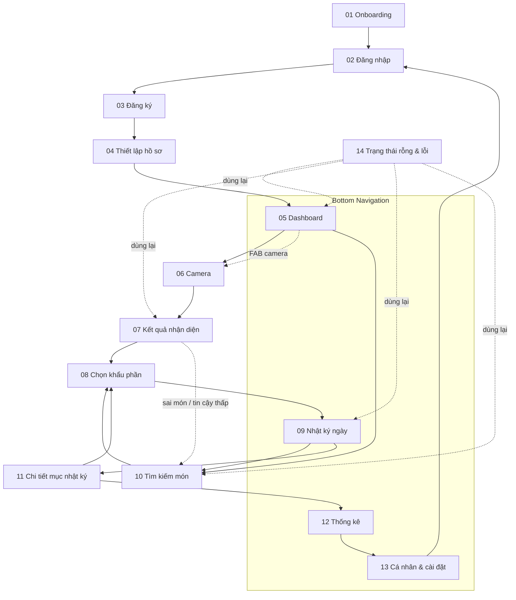

# SƠ ĐỒ LUỒNG MÀN HÌNH & ĐIỀU HƯỚNG — NUTRIVISION

> Tài liệu xác định 14 màn hình, quan hệ giữa chúng và tên route để dựng `NavHost` (Jetpack Compose Navigation) ở Tuần 4. Bản thiết kế tương ứng nằm ở trang `02 · Screen Flow` trong file Figma.

**Nguyên tắc:** ứng dụng chạy **offline hoàn toàn**. Nhận diện bằng TFLite trên máy, dữ liệu trong Room, tài khoản cục bộ. Không có Gemini, Firebase hay API mạng.

---

## 1. Sơ đồ điều hướng

- Mũi tên liền: luồng chính.
- Mũi tên chấm: lối tắt / luồng phụ.
- 14 không phải màn riêng — là bộ trạng thái dùng lại ở 05, 07, 09, 10.

---

## 2. Bảng route đề xuất

| # | Màn hình | Route | Ghi chú |
|---|---|---|---|
| 01 | Onboarding | `onboarding` | Chỉ hiện lần đầu (flag trong DataStore) |
| 02 | Đăng nhập | `login` | |
| 03 | Đăng ký | `register` | |
| 04 | Thiết lập hồ sơ | `profile_setup` | Bắt buộc sau đăng ký |
| 05 | Dashboard | `home` | Tab 1 |
| 06 | Camera | `camera` | Mở từ FAB |
| 07 | Kết quả nhận diện | `result/{imageUri}` | Truyền URI ảnh |
| 08 | Chọn khẩu phần | `portion/{foodId}?grams={g}` | `grams` tùy chọn khi sửa |
| 09 | Nhật ký ngày | `diary?date={epochDay}` | Tab 2 |
| 10 | Tìm kiếm món | `search` | |
| 11 | Chi tiết mục | `entry/{entryId}` | |
| 12 | Thống kê | `stats` | Tab 3 |
| 13 | Cá nhân & cài đặt | `settings` | Tab 4 |

---

## 3. Ba luồng người dùng chính

### Luồng 1 — Người dùng mới

1. **01 Onboarding:** 3 giá trị cốt lõi (nhận diện trên máy · khẩu phần Việt · dữ liệu cục bộ). Bấm **“Bắt đầu ngay”**.
2. **02 Đăng nhập → 03 Đăng ký:** email + mật khẩu, kiểm tra độ dài và khớp mật khẩu. Tài khoản lưu cục bộ, không cần mạng.
3. **04 Thiết lập hồ sơ:**
   - Giới tính, chiều cao, cân nặng, mức vận động.
   - App tính **BMR → TDEE → mục tiêu calo** (giảm 20% nếu chọn giảm cân).
   - Hiển thị ngay “Mục tiêu đề xuất 1.940 kcal/ngày” kèm giải thích.
4. **05 Dashboard:** vòng calo, macro, 4 bữa. Hoàn tất onboarding.

### Luồng 2 — Nhận diện ảnh & ghi bữa (luồng trọng tâm)

1. Từ **05 Dashboard**, bấm **FAB camera** ở giữa bottom nav (hoặc nút `+` ở một bữa).
2. **06 Camera:**
   - Khung ngắm 286 × 286, nút flash, shutter giữa.
   - Chọn **chụp trực tiếp** hoặc **thư viện**.
3. **07 Kết quả nhận diện:**
   - Model TFLite trả **top-3** với xác suất.
   - Món cao nhất ≥ 60%: hiện tên + thanh tin cậy + 2 gợi ý phụ.
   - Món cao nhất < 60%: hiện top-3 ngang nhau + nút **“Tìm món thủ công”** (trạng thái ở màn 14), **không đoán bừa**.
4. **08 Chọn khẩu phần:**
   - Segmented: Nửa tô · 1 tô · Tô lớn, hoặc nhập số gram.
   - Dinh dưỡng tính lại ngay: `định lượng/100 g × gram`.
   - Cảnh báo khi natri gần 2.000 mg/ngày.
   - Bấm **“Lưu vào bữa trưa”** → ghi Room → quay về 09/05, hiện snackbar **“Đã thêm vào bữa trưa”** + **Hoàn tác** (5 giây).
5. Nếu AI sai: chọn gợi ý phụ hoặc **10 Tìm kiếm** → chọn món → quay lại 08.

### Luồng 3 — Tìm món & theo dõi

1. **10 Tìm kiếm:** gõ có dấu hoặc không dấu (`phở bò` / `pho bo`), lọc theo nhóm món.
2. Chọn món → **08 Chọn khẩu phần** → lưu.
3. **09 Nhật ký:** xem theo ngày, sửa/xóa từng mục.
4. **11 Chi tiết mục:** xem lại dinh dưỡng; **Sửa khẩu phần** quay lại 08; **Xóa** có xác nhận + hoàn tác.
5. **12 Thống kê:** 7/30 ngày, cột calo so với vạch mục tiêu, donut macro, gợi ý ngắn.
6. **13 Cá nhân:** đổi mục tiêu, bật nhắc bữa ăn, xuất CSV, xóa dữ liệu, đăng xuất.

---

## 4. Quy ước điều hướng

| Tình huống | Hành vi |
|---|---|
| Bottom nav | 4 tab: Trang chủ · Nhật ký · Thống kê · Cá nhân; giữ trạng thái từng tab |
| FAB camera | Luôn mở 06, không đổi tab hiện tại |
| Back | Quay lại màn trước; ở 05/09/12/13 thì thoát app sau khi xác nhận (double-back) |
| Lưu thành công | Quay về màn gọi (08 → 09 hoặc 05), không tạo màn mới |
| Xóa mục | Ở lại 09, snackbar hoàn tác 5 giây |
| Mất dữ liệu / lỗi đọc model | Hiện banner lỗi ở màn 14, không crash |
| Onboarding | Chỉ chạy lần đầu; các lần sau vào thẳng 05 nếu đã có hồ sơ |

---

## 5. Ánh xạ sang Compose (Tuần 4)

- `NavHost` khai báo 12 route ở bảng trên; 14 là tập component trạng thái, không phải route.
- Bottom nav dùng `NavHostController` + `currentBackStackEntryAsState()` để tô tab active.
- `result/{imageUri}` và `entry/{entryId}` là route có tham số — không truyền object qua bundle.
- Snackbar dùng `SnackbarHostState` ở `Scaffold` gốc để hiển thị ở mọi màn.
