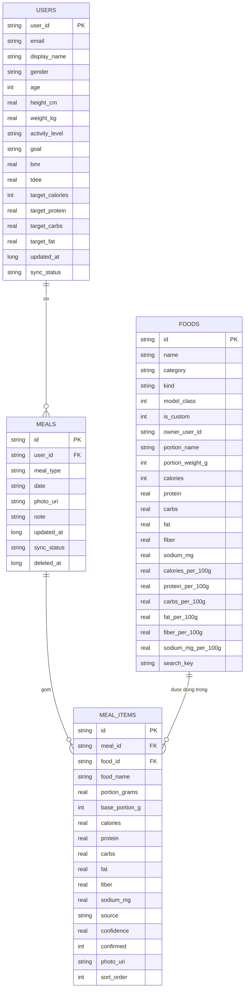

# Tuần 3 — Cơ sở dữ liệu và kiến trúc

Tài liệu thiết kế trước khi viết code. Chốt xong file này mới sinh entity/DAO.

**Bản 2:** đổi từ 3 bảng sang **4 bảng** — tách `meals` (một lần ăn) khỏi `meal_items` (các món trong lần ăn đó).

---

## 0. Làm xong tuần 3 thì app chạy được tới đâu

| Màn hình | Trước tuần 3 | Sau tuần 3 |
|---|---|---|
| Đăng nhập | Bấm là vào, không lưu ai | Vẫn chưa có Firebase Auth, nhưng đã có `users` trong DB (`user_id = "local"`) |
| Hồ sơ | 3 ô nhập, bấm không làm gì | Lưu thật vào `users`, tính **BMR / TDEE / mục tiêu calo + 3 macro**, mở lại vẫn còn |
| Trang chủ | "1.250 kcal", "45g / 110g" là số cứng | **Số thật** lấy từ DB, đổi theo bữa ăn đã ghi và mục tiêu trong hồ sơ |
| 4 bữa trong ngày | 4 thẻ tĩnh | Đọc từ `meals` + `meal_items`: bữa nào có món thì hiện tên + tổng calo bữa đó |
| Chi tiết món | Tên món cứng "Phở bò tái nạm", 450 kcal cứng | Đọc món thật trong `foods`; **kéo gram → calo/đạm/carb/béo đổi theo**; lưu/sửa/xoá được |
| Tìm món | Chưa có | Tìm trong **145 món**, gõ không dấu vẫn ra ("pho bo" → Phở bò) |
| Tắt app mở lại | Mất hết | **Dữ liệu còn nguyên** |

**Chưa có sau tuần 3** (đúng phạm vi tuần 4–5): chụp ảnh thật, model TFLite nhận diện, gọi Gemini, đồng bộ Firebase, biểu đồ 7 ngày, đăng nhập thật.

Nói cách khác: sau tuần 3 app **là một ứng dụng nhật ký dinh dưỡng chạy được thật**, nhưng chưa phải ứng dụng "AI nhận diện ảnh". Món ăn lúc này do người dùng tìm/chọn, không do model đoán.

---

## 1. Chọn cách lưu trữ

| Dữ liệu | Lưu ở đâu | Vì sao |
|---|---|---|
| Hồ sơ, bữa ăn, món trong bữa | **Room (SQLite) — nguồn chính** | Phải xem lại bữa ăn khi không có mạng |
| Danh mục 145 món + dinh dưỡng | **Room, seed từ `assets/foods_nutrition.json`** | Có sẵn trong app, không cần mạng, tìm bằng SQL |
| Món người dùng tự thêm | **Room**, `foods.is_custom = 1` | Không có trong danh mục 131 lớp |
| Ảnh món đã chụp | File trong bộ nhớ app, chỉ lưu đường dẫn | Ảnh nặng, không nhét vào DB |
| Đồng bộ nhiều máy | **Firebase (tuần 4–5)** | Đẩy/lấy khi có mạng, không chặn thao tác offline |

Nguyên tắc: **Room là sự thật duy nhất**. Firebase chỉ ghi vào Room, UI không đọc trực tiếp Firebase.

---

## 2. Mô hình dữ liệu — 4 bảng

```
┌────────────────────┐
│ users              │  1 dòng / người dùng (demo: "local")
│ PK user_id         │
│    email, tên      │
│    tuổi, cao, nặng │
│    vận động, goal  │
│    bmr, tdee       │
│    target_*        │
└─────────┬──────────┘
          │ 1
          │ N
┌─────────▼──────────┐        ┌──────────────────────────┐
│ meals              │  1   N │ meal_items               │
│ PK id (UUID)       │◄───────┤ PK id (UUID)             │
│ FK user_id         │        │ FK meal_id  (CASCADE)    │
│    meal_type       │        │ FK food_id  (SET NULL)   │
│    date            │        │    food_name (snapshot)  │
│    photo_uri       │        │    portion_grams         │
│    note            │        │    base_portion_g        │
└────────────────────┘        │    kcal/P/C/F/xơ/Na      │
                              │    source, confidence    │
                              │    photo_uri, sort_order │
                              └────────────┬─────────────┘
                                           │ N
                                           │ 1
                              ┌────────────▼─────────────┐
                              │ foods                    │
                              │ PK id ("pho")            │
                              │    category (viet/intl)  │
                              │    kind (dish/topping)   │
                              │    is_custom, owner      │
                              │    portion_*             │
                              │    kcal… / *_per_100g    │
                              │    search_key            │
                              └──────────────────────────┘
```



### Vì sao 4 bảng chứ không phải 3

Một bữa trưa có thể gồm **cơm tấm + trứng ốp la + trà đá**. Ba thứ đó là 3 dòng `meal_items` nhưng chỉ là **một lần ăn**: chung ngày, chung ảnh, chung nhãn "Bữa trưa". Nếu gộp món và bữa làm một (bản 1 của tài liệu này) thì:

- không có chỗ lưu ảnh/ghi chú **của cả bữa**;
- không xoá được cả bữa bằng một thao tác;
- mỗi lần thêm món phải tự đoán "bữa trưa hôm nay đã tồn tại chưa".

Tách ra thì `meals` là **sự kiện**, `meal_items` là **dòng chi tiết**. Đây là mô hình hoá đúng, không phải làm cho nhiều bảng.

### 2.1. `users` — 1 dòng / người dùng

| Cột | Kiểu | Ghi chú |
|---|---|---|
| `user_id` | TEXT **PK** | Demo `"local"`; sau này là Firebase UID |
| `email` | TEXT | **Không lưu mật khẩu** — Firebase Auth giữ |
| `display_name` | TEXT? | |
| `gender` | TEXT | `male` / `female` |
| `age` | INT | |
| `height_cm` | REAL | |
| `weight_kg` | REAL | |
| `activity_level` | TEXT | `sedentary` / `light` / `moderate` / `active` / `very_active` |
| `goal` | TEXT | `lose` / `maintain` / `gain` |
| `bmr` | REAL | Mifflin–St Jeor |
| `tdee` | REAL | BMR × hệ số vận động |
| `target_calories` | INT | TDEE ± 15 % theo `goal` |
| `target_protein` / `target_carbs` / `target_fat` | REAL | g/ngày |
| `created_at` / `updated_at` | INTEGER | epoch millis |
| `sync_status` | TEXT | `synced` / `pending` |

Lưu sẵn `bmr`, `tdee`, `target_*` để Dashboard hiện ngay, không tính lại mỗi lần vẽ.

### 2.2. `foods` — danh mục món (đọc + món tự thêm)

| Cột | Kiểu | Ghi chú |
|---|---|---|
| `id` | TEXT **PK** | Trùng `labels.txt`: `pho`, `banh_bao`; món tự thêm: `custom_<uuid>` |
| `name` | TEXT | "Bánh bao xá xíu trứng cút" |
| `category` | TEXT | `vietnamese` / `international` — **giữ đúng nghĩa cũ** (thống kê 101/30) |
| `kind` | TEXT | `dish` / `topping` / `drink` — **cột mới, tách khỏi `category`** |
| `model_class` | INTEGER | 1 = 131 lớp model nhận diện được; 0 = chỉ tra cứu tay |
| `is_custom` | INTEGER | 1 = người dùng tự thêm |
| `owner_user_id` | TEXT? | NULL = danh mục hệ thống; có giá trị = món riêng của user đó |
| `portion_name` | TEXT | "1 cái lớn (180g)", topping: "1 quả (60g)" |
| `portion_weight_g` | INT | khẩu phần gốc |
| `calories` … `sodium_mg` | INT/REAL | số cho **đúng khẩu phần gốc** |
| `calories_per_100g` … `sodium_mg_per_100g` | REAL | 6 cột, để nhân lại khi đổi khẩu phần |
| `search_key` | TEXT | tên bỏ dấu + lowercase: `"pho bo tai nam"` → gõ "pho bo" vẫn ra |
| `description`, `source`, `method`, `confidence` | TEXT? | metadata, không hiện UI |
| `created_at` / `updated_at` / `deleted_at` | INTEGER | món tự thêm cần đồng bộ |

**Sửa so với đề xuất:** không dùng `category = 'topping'`. `category` đang mang nghĩa Việt/ngoại và đã dùng để đếm 101 lớp Việt + 30 lớp ngoại; nhét `topping` vào sẽ làm hỏng thống kê. Thêm cột `kind` riêng — topping vẫn là một món bình thường, chỉ khác nhãn.

**Món ngoài danh mục cũng là `foods`.** Gemini trả tên lạ → tạo `foods` với `is_custom = 1`, `source = 'gemini'`, dinh dưỡng NULL (hoặc số người dùng tự nhập). Không bịa calo, mà vẫn lưu được để lần sau tái sử dụng.

Danh mục hệ thống seed một lần, 145 dòng. Nếu JSON đổi: tăng `seed_version` trong `SharedPreferences`, xoá và seed lại **chỉ các dòng `is_custom = 0`** — không đụng món người dùng tạo.

### 2.3. `meals` — một lần ăn

| Cột | Kiểu | Ghi chú |
|---|---|---|
| `id` | TEXT **PK** | UUID — dùng luôn làm id Firestore |
| `user_id` | TEXT **FK** → `users.user_id`, `ON DELETE CASCADE` | |
| `meal_type` | TEXT | `breakfast` / `lunch` / `dinner` / `snack` |
| `date` | TEXT | `"2026-11-07"` theo giờ máy — để `GROUP BY` không đổi múi giờ |
| `eaten_at` | INTEGER | epoch millis, thời điểm ghi |
| `photo_uri` | TEXT? | ảnh chung của bữa (không bắt buộc) |
| `note` | TEXT? | |
| `created_at` / `updated_at` | INTEGER | |
| `deleted_at` | INTEGER? | **xoá mềm** — giữ dòng để đồng bộ đi xoá |
| `sync_status` | TEXT | `synced` / `pending` / `pending_delete` |

Ràng buộc: **mỗi ngày mỗi loại bữa chỉ có 1 dòng** → `UNIQUE(user_id, date, meal_type)`. Thêm món vào bữa trưa = `INSERT OR IGNORE` bữa trưa rồi thêm `meal_item`.

**Sửa so với đề xuất:** không lưu `total_calories` trong `meals`. Tổng là dữ liệu **suy ra**; lưu cứng thì sửa/xoá một món mà quên cập nhật là Dashboard hiện sai. Tính bằng `SUM` trên `meal_items` (có index, 1 câu SQL cho cả 4 bữa).

### 2.4. `meal_items` — một món trong bữa

| Cột | Kiểu | Ghi chú |
|---|---|---|
| `id` | TEXT **PK** | UUID |
| `meal_id` | TEXT **FK** → `meals.id`, `ON DELETE CASCADE` | xoá bữa là xoá sạch món |
| `food_id` | TEXT? **FK** → `foods.id`, `ON DELETE SET NULL` | NULL nếu món bị xoá khỏi danh mục |
| `food_name` | TEXT | **bản sao tên lúc lưu** |
| `portion_grams` | REAL | **số gram người dùng chọn** — nguồn duy nhất để tính |
| `base_portion_g` | INT | khẩu phần gốc lúc lưu, để hiện "x1,5" và dựng lại chip Nhỏ/Vừa/Lớn |
| `calories` … `sodium_mg` | REAL | **bản sao dinh dưỡng đã tính** |
| `source` | TEXT | `model` / `gemini` / `user` |
| `confidence` | REAL? | xác suất model, NULL nếu nhập tay |
| `confirmed` | INTEGER | 0/1 — người dùng đã xác nhận món |
| `photo_uri` | TEXT? | **ảnh của lần chụp ra món này** |
| `sort_order` | INT | thứ tự hiện trong bữa |
| `created_at` / `updated_at` / `deleted_at` | INTEGER | |

**Không có cột `portion_multiplier`.** Gram là số thật để tính; "x1,5" chỉ là nhãn cho dễ đọc, suy ra lúc hiển thị:

```
multiplier = portion_grams / base_portion_g
```

Lưu riêng thì chỉ có thêm một chỗ để lệch: người dùng kéo thành 450 g mà cột multiplier vẫn ghi 1,5. Các chip "Nhỏ / Vừa / Lớn" trên UI cũng chỉ là lối tắt để **đặt gram** (350 / 500 / 700 g), không phải một khái niệm dữ liệu khác.

**Vì sao sao chép dinh dưỡng vào `meal_items`:** bữa ăn là bản ghi lịch sử. Sửa `foods.calories` sau này **không được** làm bữa ăn tháng trước tự đổi số. Giống hoá đơn lưu giá lúc mua.

**Vì sao ảnh nằm ở `meal_items` chứ không phải `meals`:** một lần chụp → một món được nhận diện. Bữa trưa 3 món chụp 3 lần thì có 3 ảnh. Ảnh chung của cả bàn ăn không có trong luồng hiện tại, nên `meals.photo_uri` để trống, chỉ dùng khi sau này cho phép chụp cả mâm.

**Topping** = một dòng `meal_items` bình thường trỏ tới `foods.kind = 'topping'`. Không cần bảng riêng.
**"Bớt bánh"** không phải topping — đó là **giảm khẩu phần của chính món gốc** (500 g → 400 g), không tạo dòng âm.

### 2.5. Index

| Bảng | Index | Phục vụ |
|---|---|---|
| `meals` | `UNIQUE(user_id, date, meal_type)` | mỗi ngày mỗi bữa 1 dòng |
| `meals` | `(user_id, date)` | lấy 4 bữa của hôm nay |
| `meal_items` | `(meal_id)` | gom món theo bữa |
| `meal_items` | `(food_id)` | món nào hay ăn |
| `meals`, `meal_items` | `(sync_status)` | quét hàng chờ đẩy Firebase |
| `foods` | `(search_key)` | tìm món không dấu |
| `foods` | `(kind)`, `(model_class)` | lọc topping / lớp model |

---

## 3. Truy vấn chính

```sql
-- 1. Bữa ăn hôm nay + tổng từng bữa (1 câu cho cả 4 bữa)
SELECT m.id, m.meal_type,
       COALESCE(SUM(i.calories), 0) AS kcal,
       COALESCE(SUM(i.protein), 0)  AS protein,
       COALESCE(SUM(i.carbs), 0)    AS carbs,
       COALESCE(SUM(i.fat), 0)      AS fat,
       COUNT(i.id) AS so_mon
FROM meals m
LEFT JOIN meal_items i ON i.meal_id = m.id AND i.deleted_at IS NULL
WHERE m.user_id = :uid AND m.date = :date AND m.deleted_at IS NULL
GROUP BY m.id
ORDER BY CASE m.meal_type
           WHEN 'breakfast' THEN 1 WHEN 'lunch' THEN 2
           WHEN 'dinner' THEN 3 ELSE 4 END;

-- 2. Tổng calo + macro cả ngày
SELECT COALESCE(SUM(i.calories),0) AS kcal,
       COALESCE(SUM(i.protein),0)  AS protein,
       COALESCE(SUM(i.carbs),0)    AS carbs,
       COALESCE(SUM(i.fat),0)      AS fat
FROM meal_items i JOIN meals m ON m.id = i.meal_id
WHERE m.user_id = :uid AND m.date = :date
  AND m.deleted_at IS NULL AND i.deleted_at IS NULL;

-- 3. 7 ngày gần nhất cho biểu đồ
SELECT m.date, SUM(i.calories) AS kcal
FROM meals m JOIN meal_items i ON i.meal_id = m.id
WHERE m.user_id = :uid AND m.deleted_at IS NULL AND i.deleted_at IS NULL
  AND m.date >= :from
GROUP BY m.date ORDER BY m.date;

-- 4. Tìm món không dấu, chỉ món ăn (không lẫn topping)
SELECT * FROM foods
WHERE search_key LIKE '%' || :q || '%' AND kind = 'dish'
ORDER BY name LIMIT 30;
```

Quy đổi khẩu phần:

```
calo_mới = calories_per_100g × portion_grams / 100
multiplier = portion_grams / base_portion_g      -- chỉ để hiển thị "x1,5", không lưu
```

Dùng `*_per_100g` chứ không chia lại từ khẩu phần gốc, để không cộng dồn sai số.

---

## 4. Kiến trúc: MVVM + Repository (manual DI)

```
Compose Screen  ──(state, event)──▶  ViewModel
      ▲                                  │
      └────── StateFlow<UiState> ────────┘
                                         ▼
                                   Repository
                          ┌──────────────┴──────────────┐
                          ▼                             ▼
                    Room DAO (local)          Firebase (tuần 4–5)
                    nguồn sự thật              chỉ ghi vào Room
```

- **UI không biết SQL, không biết Firebase.** Màn hình chỉ nhận `UiState` và gửi event.
- **Repository là chỗ duy nhất** quyết định lấy dữ liệu ở đâu.
- **Manual DI** (`AppContainer`) thay vì Hilt: dự án nhỏ, tránh thêm plugin thứ hai dễ vỡ với AGP 9.
- Tầng `domain` chỉ chứa logic thuần (BMI/TDEE, quy đổi khẩu phần) — test bằng JUnit, không cần máy ảo.

### Cấu trúc thư mục

```
com/example/nutrivision/
├── NutriVisionApp.kt              Application, tạo AppContainer
├── MainActivity.kt                (giữ nguyên, sau đó nối ViewModel)
├── di/AppContainer.kt             khởi tạo DB, DAO, Repository
├── data/
│   ├── local/
│   │   ├── NutriVisionDatabase.kt
│   │   ├── entity/                UserEntity, FoodEntity, MealEntity, MealItemEntity
│   │   ├── dao/                   UserDao, FoodDao, MealDao, MealItemDao
│   │   ├── relation/              MealWithItems, DailyTotal
│   │   └── seed/FoodSeeder.kt     đọc assets/foods_nutrition.json
│   ├── mapper/                    Entity ↔ domain model
│   └── repository/                UserRepository, FoodRepository, MealRepository
├── domain/
│   ├── model/                     User, Food, Meal, MealItem, DailySummary, MealType, EntrySource
│   └── calc/                      BmiTdeeCalculator, PortionCalculator
└── ui/
    ├── screens/                   (5 màn hiện có)
    ├── components/
    └── viewmodel/                 DashboardViewModel, MealDetailViewModel, ProfileViewModel
```

---

## 5. Đồng bộ Firebase (thiết kế trước, làm tuần 4–5)

| Bước | Việc |
|---|---|
| 1 | Ghi local → `sync_status = pending` |
| 2 | Có mạng → đẩy `users/{uid}`, `users/{uid}/meals/{id}` (kèm `items` là mảng con) |
| 3 | Xoá → `deleted_at` + `pending_delete`, đẩy xong thì xoá cứng |
| 4 | Kéo về → so `updated_at`, bên nào mới hơn thắng (last-write-wins) |
| 5 | `foods` hệ thống **không** đồng bộ; chỉ `is_custom = 1` mới đẩy lên |

---

## 6. CRUD cơ bản phải chạy được trong tuần này

| Thao tác | Màn hình | Ghi chú |
|---|---|---|
| **Thêm** bữa ăn (tạo `meals` nếu chưa có + `meal_items`) | MealDetail → "Lưu vào bữa ăn" | 1 transaction |
| **Đọc** 4 bữa hôm nay + tổng calo | Dashboard | 1 câu SQL (mục 3.1) |
| **Sửa** khẩu phần / đổi bữa / xoá món | MealDetail mở lại | cập nhật item, tổng tự đổi |
| **Xoá** cả bữa | Dashboard | xoá mềm `meals` → cascade item |
| **Cập nhật** hồ sơ + tính lại mục tiêu | Profile | upsert `users` |
| **Thêm** món tự tạo | Tìm món / Gemini trả tên lạ | `foods.is_custom = 1` |
| **Đọc** danh mục + tìm món | Tìm món thủ công | `searchFoods` |

---

## 7. Kế hoạch thực hiện

| # | Việc | Giờ | Xong khi |
|---|---|---|---|
| 0 | Duyệt tài liệu này | — | Bạn OK schema |
| 1 | Thêm Room + KSP + `lifecycle-viewmodel-compose`; build thử 1 entity | 1 | `assembleDebug` xanh |
| 2 | 4 entity, 4 DAO, Database, mapper, `exportSchema` | 3 | build xanh, schema JSON sinh ra |
| 3 | `FoodSeeder` đọc JSON → 145 dòng `foods` | 1 | đếm đúng 145, tìm "pho bo" ra |
| 4 | `AppContainer` + 3 Repository + ViewModel Dashboard/MealDetail/Profile | 3 | UI đọc dữ liệu thật, hết số giả |
| 5 | CRUD: thêm/sửa/xoá bữa ăn & món, lưu hồ sơ, tính TDEE | 2 | thao tác xong Dashboard đổi ngay |
| 6 | Test: tắt app mở lại còn dữ liệu; tổng calo khớp tay; unit test TDEE | 1 | 3 test pass |
| 7 | Vẽ ERD + chụp màn hình + ghi báo cáo | 1 | có ảnh và bảng cho tuần 3 |

Tổng ~12 giờ, chia 3 buổi.

**Rủi ro đã lường trước:** AGP 9.3.3 dùng Kotlin tích hợp sẵn, KSP của Room có thể không tương thích. Bước 1 build thử ngay; nếu fail → dùng `SQLiteOpenHelper` với **đúng schema trên** (chỉ đổi lớp truy cập, không đổi thiết kế).

---

## 8. Không làm trong tuần này

- Firebase Auth / Firestore thật, gọi Gemini, chạy TFLite (tuần 4–5).
- Bảng `recognition_log` lưu top-3 để cải thiện dataset — để sau, khi có ảnh thật.
- Bảng `daily_summary` cache tổng ngày — chưa cần, `SUM` đã đủ nhanh với vài nghìn dòng.
